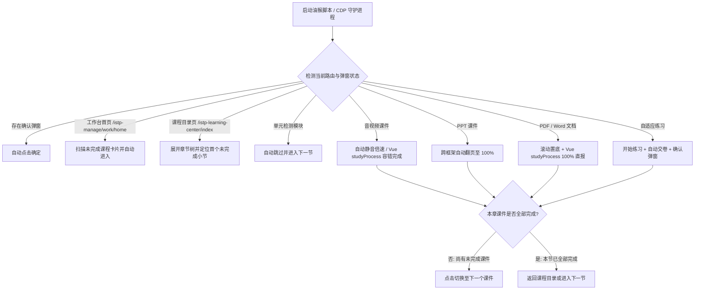

# FIF 智慧教学平台全自动刷课项目

适用于 **FIF 智慧教学平台 / 讯飞高教自适应学习系统**（<https://icourse.fifedu.com/istp-manage/work/home> 及全站课程页）的全自动辅助学习工具集，提供 **通用油猴脚本（UserScript）** 与 **本地 Python CDP 守护脚本** 双方案。

- **GreasyFork 在线安装地址**：[FIF智慧教学平台全自动刷课助手 (GreasyFork #604397)](https://greasyfork.org/zh-CN/scripts/604397-fif%E6%99%BA%E6%85%A7%E6%95%99%E5%AD%A6%E5%B9%B3%E5%8F%B0%E5%85%A8%E8%87%AA%E5%8A%A8%E5%88%B7%E8%AF%BE%E5%8A%A9%E6%89%8B-icourse-fifedu-com)

## 项目文件结构

| 文件名 | 类型 | 说明 |
| :--- | :--- | :--- |
| [`fif-auto-study.user.js`](./fif-auto-study.user.js) | UserScript | 符合 GreasyFork 上架规范的全站通用油猴脚本，带可视化悬浮面板、双引擎进度同步及多课程连刷 |
| [`GREASYFORK_README.md`](./GREASYFORK_README.md) | Markdown | GreasyFork 脚本发布说明与上架元数据对照表 |
| [`master_auto_study.py`](./master_auto_study.py) | Python | 基于 Chrome DevTools Protocol (CDP) 的全站课程巡航与自动化主程序 |
| [`cdp_client.py`](./cdp_client.py) | Python | 底层 CDP WebSocket 通信、页面目标附着、DOM 评估与硬件输入模拟客户端封装 |
| [`auto_study_daemon.py`](./auto_study_daemon.py) | Python | 单持久连接 CDP 守护进程独立版（无需外部模块依赖，仅需 `websockets`） |

## 支持的学习资源处理矩阵

| 资源类别 | 识别特征 | 核心自动化行为 | 结算与流转 |
| :--- | :--- | :--- | :--- |
| **音视频课件** | `<video>`、`.mp4`、`.mp3`、`xgplayer` | 自动静音播放、自定义倍速（`1x` ~ `16x`）、极速完成，以及针对平台损坏视频源（`MEDIA_ELEMENT_ERROR`）的容错直报 | 完成后自动切下一课件或下一节 |
| **PPT 课件** | `.ppt`、`.pptx`、`.pptIframe`、`ow365` | 自动聚焦幻灯片或调用跨框架翻页，连续推进至最后一页 | 达末页后自动切下一课件或下一节 |
| **Word 文档** | `.doc`、`.docx` | 自动定位阅读容器与滚动条，分步平滑拉到底部并保持阅读心跳 | 触发学时同步后切下一课件或下一节 |
| **PDF 课件** | `.pdf`、`PDFViewerApplication` | 跨框架操控 `PDF.js` 跳至末页置底，并结合 Vue 3 底层 `studyProcess` 接口直报，解决单页 PDF 不打勾问题 | 同步完成后切下一课件或下一节 |
| **自适应练习** | `自适应练习`、`.CloseBtn` | 自动点击「开始练习 / 继续练习」，就绪后自动点击「交卷」并确认弹窗 | 提交成功后切下一课件或下一节 |
| **单元检测** | 标题含 `单元检测` / `单元测验` / `考试` | 默认识别为阶段测验模块，免答直接跳过 | 自动跳转至下一学习小节 |

## 自动化流转架构



## 快速开始

### 方案一：浏览器油猴脚本（推荐）

1. 在浏览器中安装 **Tampermonkey（篡改猴）** 或 **Violentmonkey（暴力猴）** 扩展。
2. 前往 [GreasyFork 脚本主页 (#604397)](https://greasyfork.org/zh-CN/scripts/604397-fif%E6%99%BA%E6%85%A7%E6%95%99%E5%AD%A6%E5%B9%B3%E5%8F%B0%E5%85%A8%E8%87%AA%E5%8A%A8%E5%88%B7%E8%AF%BE%E5%8A%A9%E6%89%8B-icourse-fifedu-com) 一键安装，或将本地 [`fif-auto-study.user.js`](./fif-auto-study.user.js) 导入油猴扩展中并启用。
3. 打开 <https://icourse.fifedu.com/istp-manage/work/home> 登录账号。
4. 点击课程卡片上的 **「🚀 自动刷此课」** 按钮，或在课程学习页点击右下角悬浮面板的 **「▶ 开始全自动刷课」**。

### 方案二：本地 Python CDP 自动化脚本

1. 确保本地已安装 Python 3 与 `websockets` 库：

   ```powershell
   pip install websockets
   ```

2. 在 Chrome 浏览器开启远程调试端口（或在 `chrome://inspect/#remote-debugging` 开启调试）并登录 FIF 平台。
3. 运行全站自动化主程序：

   ```powershell
   python master_auto_study.py
   ```
