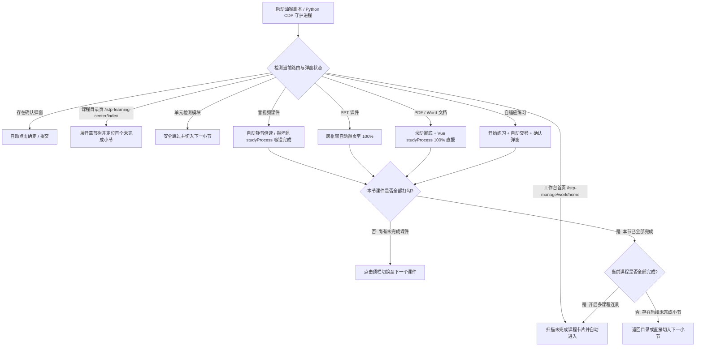

# FIF 智慧教学平台全自动刷课助手

[](https://greasyfork.org/zh-CN/scripts/604397-fif%E6%99%BA%E6%85%A7%E6%95%99%E5%AD%A6%E5%B9%B3%E5%8F%B0%E5%85%A8%E8%87%AA%E5%8A%A8%E5%88%B7%E8%AF%BE%E5%8A%A9%E6%89%8B-icourse-fifedu-com)
[](https://github.com/hermes186/Fifedu-)
[](./fif-auto-study.user.js)
[](./master_auto_study.py)
[](https://github.com/hermes186/Fifedu-)
[](https://github.com/hermes186/Fifedu-)

> 专为 **FIF 智慧教学平台 / 讯飞高教自适应学习系统**（[icourse.fifedu.com](https://icourse.fifedu.com/istp-manage/work/home)）打造的全自动辅助学习工具集。
> 提供 **浏览器油猴脚本（UserScript）** 与 **本地 Python CDP 守护进程** 双引擎方案，支持多课程连刷、全类型课件自动完成、损坏视频源容错直报及单元检测安全跳过。

---

## 在线安装与快捷入口

- **GreasyFork 在线一键安装**：[FIF智慧教学平台全自动刷课助手 (GreasyFork #604397)](https://greasyfork.org/zh-CN/scripts/604397-fif%E6%99%BA%E6%85%A7%E6%95%99%E5%AD%A6%E5%B9%B3%E5%8F%B0%E5%85%A8%E8%87%AA%E5%8A%A8%E5%88%B7%E8%AF%BE%E5%8A%A9%E6%89%8B-icourse-fifedu-com)
- **本地 UserScript 源码**：[`fif-auto-study.user.js`](./fif-auto-study.user.js)
- **GitHub 仓库地址**：[hermes186/Fifedu-](https://github.com/hermes186/Fifedu-)
- **适用域名范围**：`icourse.fifedu.com`、`resc.fifedu.com`、`*.ow365.cn`

---

## 核心特性亮点

- **全站路由感知与多课程连刷**：自动识别工作台首页（`/istp-manage/work/home`）「我学的课」列表，在每张课程卡片注入 **「🚀 自动刷此课」** 快捷按钮；支持当前课程结课后自动返回首页切入下一门未完成课程。
- **Vue 3 底层直报 + DOM 双重驱动**：除模拟真实滚动、翻页与倍速播放外，直接对接平台底层 Vue 3 组件 `studyProcess(100)` 接口，彻底攻克 **单页 PDF 不打勾** 与 **平台视频源损坏（`MEDIA_ELEMENT_ERROR`）卡死** 两大顽疾。
- **跨域子框架协同穿透**：内置 `resc.fifedu.com`（`PDF.js` 阅读器）与 `ow365.cn`（PPT 预览器）子框架自动化模块，跨 `iframe` 自动跳至末页并触发学时结算。
- **防死锁与测验安全保护**：默认精准识别并跳过 **单元检测 / 单元测验 / 期中期末考试**；内置异常小节防死循环缓存，单次无法打勾的小节自动记录跳过，保障无人值守连续运行。
- **现代化暗色悬浮控制面板**：油猴脚本内置可拖拽、可最小化的毛玻璃暗色面板，支持实时查看运行状态、滚动日志、切换视频倍速与策略开关。

---

## 支持的学习资源处理矩阵

| 资源类别 | 识别特征 | 核心自动化机制 | 异常容错与结算流转 |
| :--- | :--- | :--- | :--- |
| **音视频课件** | `<video>`、`.mp4`、`.mp3`、`xgplayer` | 自动静音播放、自定义倍速（`1x` ~ `16x`）、极速完成 | 遇 `MEDIA_ELEMENT_ERROR` 损坏视频源自动触发 Vue `studyProcess` 容错直报并切下一项 |
| **PPT 课件** | `.ppt`、`.pptx`、`.pptIframe`、`ow365` | 跨框架聚焦幻灯片并调用翻页接口，连续推进至末页 | 抵达最后一页并同步 100% 进度后自动切下一课件或下一节 |
| **PDF 课件** | `.pdf`、`PDFViewerApplication` | 操控 `PDF.js` 跳至末页置底 + 调用 Vue 3 `studyProcess(100)` | 解决单页 PDF 无滚动事件导致不打勾问题，完成后自动流转 |
| **Word / 文档** | `.doc`、`.docx`、`.txt`、`.xls` | 自动定位阅读容器与滚动条，分步平滑置底并维持阅读心跳 | 触发学时同步打勾后自动切下一课件或下一节 |
| **自适应练习** | `自适应练习`、`.CloseBtn` | 自动点击「开始练习 / 继续练习」→「交卷」→ 确认弹窗 | 交卷结算完成后自动进入下一课件或下一小节 |
| **单元检测** | 标题含 `单元检测` / `单元测验` / `考试` | 默认识别为阶段考核模块，免答直接保护性跳过 | 记入本轮跳过队列并自动跳转至下一学习小节 |

---

## 双方案对比与选型指南

| 对比维度 | 方案一：浏览器油猴脚本（推荐） | 方案二：Python CDP 守护进程 |
| :--- | :--- | :--- |
| **核心文件** | [`fif-auto-study.user.js`](./fif-auto-study.user.js) | [`master_auto_study.py`](./master_auto_study.py) / [`auto_study_daemon.py`](./auto_study_daemon.py) |
| **运行依赖** | Tampermonkey / Violentmonkey / ScriptCat 扩展 | Python 3.8+、`websockets` 库、Chrome 调试端口 |
| **交互界面** | 页面内嵌课程卡片按钮 + 右下角可视化悬浮面板 | 终端命令行实时日志输出 |
| **跨域穿透方式** | 多 `@match` 域名子框架注入协同 | CDP Target 多目标附着 + OS 级原生输入事件 |
| **适用人群** | 绝大多数普通用户，追求即装即用、零环境配置 | 开发者或需要外部进程级守护、批量无人值守场景 |

---

## 自动化流转架构



---

## 快速开始

### 方案一：浏览器油猴脚本（推荐）

1. **安装脚本管理器**：在浏览器中安装 [Tampermonkey（篡改猴）](https://www.tampermonkey.net/)、[Violentmonkey（暴力猴）](https://violentmonkey.github.io/) 或 [ScriptCat（脚本猫）](https://docs.scriptcat.org/) 扩展。
2. **安装刷课脚本**：前往 [GreasyFork 脚本发布页 (#604397)](https://greasyfork.org/zh-CN/scripts/604397-fif%E6%99%BA%E6%85%A7%E6%95%99%E5%AD%A6%E5%B9%B3%E5%8F%B0%E5%85%A8%E8%87%AA%E5%8A%A8%E5%88%B7%E8%AF%BE%E5%8A%A9%E6%89%8B-icourse-fifedu-com) 点击「安装此脚本」，或将仓库中的 [`fif-auto-study.user.js`](./fif-auto-study.user.js) 导入油猴扩展并保存。
3. **登录学习平台**：打开 [FIF 智慧教学平台学习空间](https://icourse.fifedu.com/istp-manage/work/home) 并登录账号。
4. **启动全自动刷课**：在「我学的课」列表页点击任意课程卡片上的 **「🚀 自动刷此课」** 按钮，或在课程学习页点击右下角悬浮面板的 **「▶ 开始全自动刷课」** 按钮。

### 方案二：本地 Python CDP 自动化脚本

1. **安装 Python 依赖**：确保本地已安装 Python 3.8+ 并安装 `websockets` 库。
2. **开启浏览器远程调试**：使用带 `--remote-debugging-port=9222` 参数的命令启动 Chrome（或在 `chrome://inspect/#remote-debugging` 中开启调试）并登录 FIF 平台。
3. **启动自动化巡航程序**：按需运行主控程序或单文件守护进程。

```powershell
# 1. 安装依赖
pip install websockets

# 2. 启动带远程调试端口的 Chrome 浏览器
chrome.exe --remote-debugging-port=9222

# 3. 运行全站多课程巡航主程序（或运行 python auto_study_daemon.py）
python master_auto_study.py
```

---

## 悬浮控制面板功能说明

油猴脚本在页面右下角提供可视化控制面板（支持鼠标拖拽移动与 `—` 按钮折叠）：

| 控件名称 | 默认状态 | 功能说明 |
| :--- | :--- | :--- |
| **▶ 开始全自动刷课 / ⏹ 暂停自动刷课** | 暂停 | 主控开关，一键启动或随时中断自动化巡航循环 |
| **⏭ 本节完成后自动下一节** | 开启 | 当前小节所有课件打勾后，自动切入下一未完成小节 |
| **📚 多课程连刷（完成后换课）** | 开启 | 当前课程全部小节完成后，自动返回学习空间首页进入下一门未完成课程 |
| **⏩ 视频倍速设置** | `16x (极速秒过)` | 支持 `1x`、`2x`、`4x`、`8x`、`16x` 及直接调用底层接口极速完成 |
| **🛡️ 自动跳过单元检测** | 开启 | 遇到标题含「单元检测 / 测验 / 考试」的章节时自动跳过，避免误交空白考卷 |

---

## 项目文件结构

```text
fifedu course-passing script/
├── fif-auto-study.user.js   # 全站通用油猴脚本（GreasyFork #604397 发行版）
├── GREASYFORK_README.md     # GreasyFork 脚本发布说明与上架元数据对照表
├── master_auto_study.py     # 基于 CDP 的全站课程巡航与自动化主程序
├── cdp_client.py            # 底层 CDP WebSocket 通信、DOM 评估与硬件输入客户端封装
├── auto_study_daemon.py     # 单持久连接 CDP 守护进程独立版（零外部模块依赖）
└── README.md                # 项目主文档
```

| 文件名 | 类型 | 核心职责说明 |
| :--- | :--- | :--- |
| [`fif-auto-study.user.js`](./fif-auto-study.user.js) | UserScript | 符合 GreasyFork 规范的纯原生 JS 油猴脚本，集成悬浮面板、Vue 进度直报及跨框架协同 |
| [`GREASYFORK_README.md`](./GREASYFORK_README.md) | Markdown | GreasyFork 商店详情页专属说明文档与脚本元数据对照表 |
| [`master_auto_study.py`](./master_auto_study.py) | Python | 基于 Chrome DevTools Protocol 的全站多课程自动巡航主控程序 |
| [`cdp_client.py`](./cdp_client.py) | Python | 封装 CDP Target 发现、WebSocket 消息收发、JS 注入评估与鼠标键盘事件模拟 |
| [`auto_study_daemon.py`](./auto_study_daemon.py) | Python | 独立单文件版 CDP 守护脚本，仅依赖 `websockets` 即可独立运行 |

---

## 常见问题与排障

- **单页 PDF 或文档到底后依然不打勾怎么办？**
  - FIF 平台部分单页 PDF 无法触发传统的跨页滚动事件。本脚本已内置 **Vue 3 实例深层遍历器**，会自动寻找当前页面挂载的 `studyProcess` 方法并直接上报 `100%` 进度，无需手动干预。
- **遇到视频黑屏或提示 `MEDIA_ELEMENT_ERROR: Format error` 怎么办？**
  - 这是平台部分老旧课程视频源地址失效导致的后端问题。脚本检测到 `video.error` 后会自动触发容错直报机制，直接完成该视频学时并切换下一节，不会卡死。
- **为什么某个小节刷完一遍后没有打勾，脚本却跳到了下一节？**
  - 为防止因平台服务端异常导致脚本在同一小节无限死循环，脚本内置了 `visitedSectionIds` 防死锁缓存，单轮巡航中已完整执行过的小节若仍未打勾，会自动挂起并优先推进其余章节。

---

## 免责声明与开源协议

- 本项目遵循 [MIT License](https://opensource.org/licenses/MIT) 开源协议发布。
- 本脚本及配套工具仅供学习 JavaScript 逆向分析、Vue 3 运行时实例通信与 Chrome DevTools Protocol 自动化技术交流使用，请勿用于任何商业用途。
